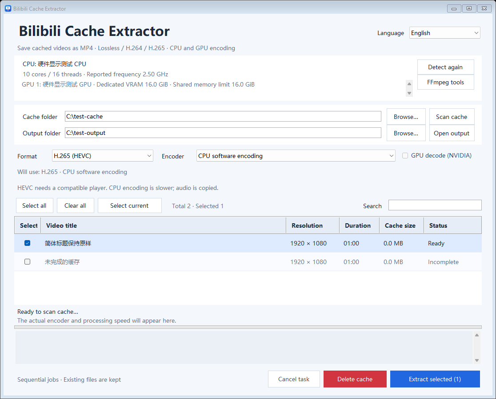
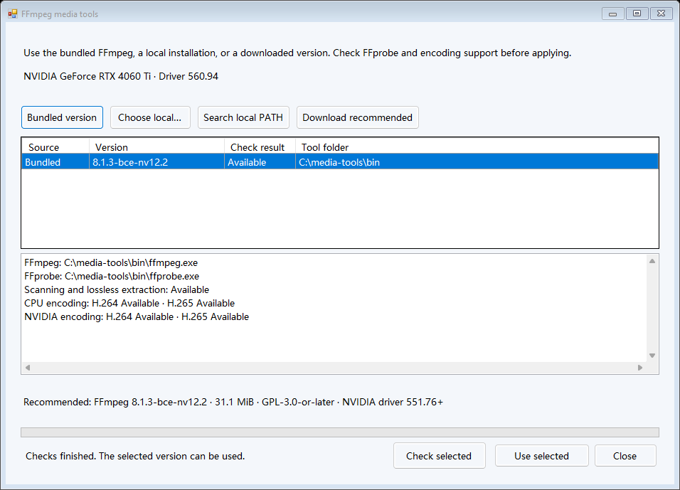

# BiliCacheExtractor

**English** | [简体中文](README.zh-CN.md) | [繁體中文](README.zh-TW.md)


Extract locally cached Bilibili videos into MP4 files on Windows. Keep the original compressed audio and video, or transcode video to H.264/H.265 using your CPU or a supported GPU.



Interface rendered with synthetic UI test data.

## Features

- Scan `.m4s` files recursively and read video and part titles from `videoInfo.json`.
- Lossless MP4 extraction, H.264 encoding and H.265/HEVC encoding.
- CPU, NVIDIA NVENC, Intel Quick Sync and AMD AMF encoder selection. Automatic mode tries available hardware before CPU.
- Batch selection, title search, progress, cancellation and unique output filenames.
- Chinese (Simplified), Chinese (Traditional) and English interfaces.
- Preview selected cache files and move them to the Windows Recycle Bin after confirmation.
- A command-line interface using the same processing engine as the desktop app.

## Get started

Download **1.4.1** from [Releases](https://github.com/Sulock/BiliCacheExtractor/releases/tag/v1.4.1): [Windows x64 package](https://github.com/Sulock/BiliCacheExtractor/releases/download/v1.4.1/BiliCacheExtractor-v1.4.1-win-x64.zip) · [Source ZIP](https://github.com/Sulock/BiliCacheExtractor/releases/download/v1.4.1/BiliCacheExtractor-v1.4.1-source.zip) · [SHA-256 checksums](https://github.com/Sulock/BiliCacheExtractor/releases/download/v1.4.1/SHA256SUMS.txt).

Tested on **Windows 11 23H2 x64 with .NET Framework 4.8.1**. The build targets x64 and uses Windows APIs for the interface, hardware information and Recycle Bin. Python is only needed if you choose to regenerate the icon.

### Download and run

1. Extract the Windows x64 package to a writable folder.
2. Start `BiliCacheExtractor.exe`. The package includes the portable **FFmpeg 8.1.3 build with NVENC API 12.2**, plus FFprobe.

Open **FFmpeg tools** beside the hardware information to use the bundled version, select a local installation, search local PATH entries, or download the recommended version. A tool check shows the exact executable paths and CPU/GPU support for H.264 and H.265. The selected FFmpeg/FFprobe pair is used consistently. If the tools are missing, the configuration window opens before the main interface.

The NVIDIA interface in the bundled build requires Windows driver **551.76 or newer**; NVIDIA H.264/H.265 encoding has been verified on an RTX 4060 Ti with driver 560.94. Lossless extraction does not require a video encoder. See [tool setup](tools/README.md) and [FFmpeg source and build information](third_party/FFMPEG-SOURCES.md).



### Build from source

1. Extract the source ZIP or clone this repository.
2. Run `Install-FFmpeg.cmd`, or configure FFmpeg/FFprobe manually as described in [media tool setup](tools/README.md).
3. Run the following from the source folder:

```powershell
powershell.exe -NoProfile -ExecutionPolicy Bypass -File .\build.ps1
```

4. Start `BiliCacheExtractor.exe`.

The build uses the Windows .NET Framework C# compiler and does not restore NuGet packages. FFmpeg is needed to run the application and media tests, but not to compile the C# application. Install .NET Framework 4.8.1 if it is missing.

## Using the desktop app

Choose your cache folder, scan it, select videos, then choose the output folder and format. The default cache path is `bilibili` inside the current user's Windows Videos folder. Output goes to `提取的视频` beside the application unless changed.

| Mode | Behavior |
| --- | --- |
| Lossless extraction | Copies compressed audio/video into MP4, preserving the source codecs and quality. Usually the fastest option. |
| H.264 | Re-encodes video for broad playback compatibility; copies audio. |
| H.265 / HEVC | Re-encodes video as HEVC, uses the MP4 `hvc1` tag and copies audio. Requires a compatible player. |

The application initializes each encoder with a short test before offering it. Automatic selection follows NVIDIA → Intel → AMD → CPU among the available encoders. If a hardware encoder fails during automatic export, the next available device is tried. A manually selected device reports its failure. NVIDIA can use GPU decoding and retry with CPU decoding when needed.

Search preserves selections, including hidden selected rows. Select all applies to the current search results; clear all removes every selection. Extraction runs sequentially. Cancel stops the current export and removes its temporary file while preserving completed files. Existing output files receive a numeric suffix instead of being overwritten.

Incomplete, damaged or missing-track caches show a status explanation. When multiple tracks are present, the scanner chooses the highest-resolution video (then the larger file) and the largest audio track. Both ordinary `.m4s` inputs and the nine-byte `000000000` prefix are handled.

### Delete cache

The red delete button opens a preview listing the selected files and their total size. The default confirmation action is Cancel. Confirming moves only the selected scanned `.m4s` and `videoInfo.json` files to the Windows Recycle Bin, where they can be restored. Exported MP4 files, unrelated files and folders are retained.

Deletion checks the scan root, file type, link paths and changes since confirmation. Locations that cannot use the supported Recycle Bin path return an error and keep their files.

### Settings and logs

Preferences are saved in `settings.json` beside the application. Language, folders, output format and device settings persist between launches. The application folder and output folder need to be writable. Logs appear in the window; CLI logs are written to the terminal. Test output is stored in `verification/`.

## Command line

```powershell
$cachePath = Join-Path ([Environment]::GetFolderPath('MyVideos')) 'bilibili'
.\BiliCacheExtractor.Cli.exe --help
.\BiliCacheExtractor.Cli.exe --hardware
.\BiliCacheExtractor.Cli.exe --scan $cachePath
.\BiliCacheExtractor.Cli.exe --export $cachePath '.\output' copy
.\BiliCacheExtractor.Cli.exe --export $cachePath '.\output' h264 --device cpu
.\BiliCacheExtractor.Cli.exe --export $cachePath '.\output' h265 --device nvidia
```

`--export` processes every extractable video in the supplied directory. Devices are `auto` (default), `cpu`, `nvidia`, `intel` and `amd`. For testing, an optional positive duration in seconds limits each export. The older `gpu` mode is an alias for `h264 --device nvidia`.

## Development and testing

```powershell
powershell.exe -NoProfile -ExecutionPolicy Bypass -File .\build.ps1
powershell.exe -NoProfile -ExecutionPolicy Bypass -File .\tests\run.ps1
```

Close the desktop app before rebuilding. Tests generate synthetic media and do not require personal Bilibili caches. Optional `-CachePath 'C:\path\to\cache'` uses an existing extractable video for cancellation testing. `-Recycle` additionally exercises real Windows recycling and restoration of files created by the tests in `verification/`.

Version 1.4.1 passed 113 checks: 21 tool-management checks, 39 media checks, 46 UI checks, and 7 Recycle Bin planning checks. Tests cover generated media, CPU and available GPU transcoding, output decoding, stream hashes, cancellation, UI languages, tool selection and verified archive installation. Intel/AMD routing uses test doubles when corresponding hardware is unavailable. Real recycle/restore is opt-in.

Source layout:

- `src/`: UI, localization, cache scanner, exporter, hardware detection and cache recycling.
- `tests/`: media, UI and recycling tests.
- `assets/`: editable SVG icon and generated PNG/ICO files.
- `tools/make-icon.py`: optional icon generator, using Python 3.9+, Pillow and NumPy.
- `build.ps1`: builds the GUI and CLI with the system C# compiler.
- `Install-FFmpeg.ps1` and `tools/ffmpeg-recommended.json`: install the pinned media-tool distribution after verifying its checksum.
- `package.ps1`: builds release packages from a committed revision, including the corresponding source ZIP and SHA-256 checksums.

To reproduce the offline package, run `powershell.exe -NoProfile -ExecutionPolicy Bypass -File .\package.ps1 -Version 1.4.1 -Commit HEAD -FFmpegArchive 'C:\path\to\FFmpeg-8.1.3-bce-nv12.2-win-x64.zip' -FFmpegSourceKit 'C:\path\to\FFmpeg-8.1.3-bce-nv12.2-source-kit.zip'`. Use the separate FFmpeg runtime ZIP and source-kit ZIP supplied with the release; the script verifies their pinned hashes. Output goes to `release-v1.4.1/`; choose a fresh `-OutputDirectory` for another build.

## Feedback

Open an [issue](https://github.com/Sulock/BiliCacheExtractor/issues) with your Windows version, application version, FFmpeg version, selected format/device and reproduction steps. Review paths, video titles and other personal information before attaching logs or screenshots.

## License

The project is licensed under **GPL-3.0-only**. See [LICENSE](LICENSE) for the complete text. FFmpeg and other external components retain their own licenses; see [third-party notices](THIRD_PARTY_NOTICES.md).

Copyright (C) 2026 Sulock.
