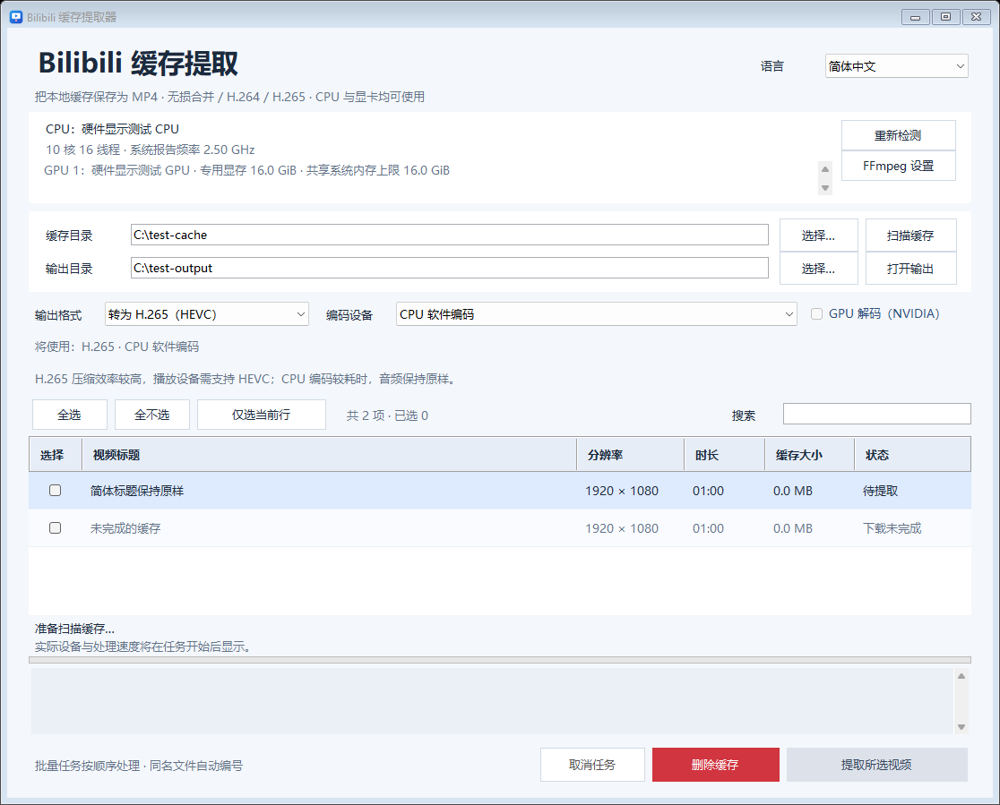

# Bilibili 缓存提取器

[English](README.md) | **简体中文** | [繁體中文](README.zh-TW.md)


把 Windows 上的 Bilibili 本地缓存保存为 MP4，支持保留原音视频压缩数据的无损提取，以及 CPU 或显卡加速的 H.264/H.265 转码。



界面截图使用合成的界面测试数据。

## 功能

- 递归扫描 `.m4s` 文件，读取 `videoInfo.json` 中的视频标题和分 P 标题。
- 无损提取、H.264 与 H.265/HEVC 三种输出模式。
- CPU、NVIDIA NVENC、Intel Quick Sync、AMD AMF 编码设备选择与自动回退。
- 批量勾选、标题搜索、进度显示、取消任务与重名文件自动编号。
- 简体中文、繁体中文和 English 界面。
- 预览待删除缓存，确认后移入 Windows 回收站。
- 与图形界面共用处理引擎的命令行入口。

## 开始使用

**1.3.1** 下载入口：[Release 页面](https://github.com/Sulock/BiliCacheExtractor/releases/tag/v1.3.1) · [Windows x64 程序包](https://github.com/Sulock/BiliCacheExtractor/releases/download/v1.3.1/BiliCacheExtractor-v1.3.1-win-x64.zip) · [源码 ZIP](https://github.com/Sulock/BiliCacheExtractor/releases/download/v1.3.1/BiliCacheExtractor-v1.3.1-source.zip) · [SHA-256 校验文件](https://github.com/Sulock/BiliCacheExtractor/releases/download/v1.3.1/SHA256SUMS.txt)。

已验证环境为 **Windows 11 23H2 x64、.NET Framework 4.8.1**。程序编译为 x64，界面、硬件检测和回收站功能使用 Windows API。只有重新生成图标时需要 Python。

### 下载运行

1. 将 Windows x64 程序包解压到可写目录。
2. 双击 `BiliCacheExtractor.exe`。程序包已包含 FFmpeg、FFprobe 及配套 DLL。

离线程序包包含编译好的 GUI、CLI、本地 FFmpeg 构建和对应的应用源码 ZIP。FFmpeg 的许可证与源码信息保存在 `tools/ffmpeg/LICENSE.txt` 和 `tools/ffmpeg/SOURCE-INFO.txt`。同一 Release 提供 [FFmpeg 源码与构建资料](https://github.com/Sulock/BiliCacheExtractor/releases/download/v1.3.1/FFmpeg-N-128122-source-build-kit.zip)，详细来源与构建方式见[源码说明](third_party/FFMPEG-SOURCES.md)。显卡驱动不支持所需 NVENC API 时，内置 FFmpeg 可使用 CPU 编码。

### 旧版 NVIDIA 驱动

另提供 [1.3.1 旧驱动兼容版](https://github.com/Sulock/BiliCacheExtractor/releases/tag/v1.3.1-legacy)。下载其 [Windows x64 程序包](https://github.com/Sulock/BiliCacheExtractor/releases/download/v1.3.1-legacy/BiliCacheExtractor-v1.3.1-legacy-win-x64.zip)，解压后先运行 `Install-Legacy-FFmpeg.cmd`，联网下载约 22 MB，随后打开软件；以后可以离线使用。脚本取得的 FFmpeg 4.2.2 与原本地兼容文件完全相同，已在 RTX 4060 Ti、驱动 560.94 上验证 NVIDIA H.264/H.265 编码，自动模式会实测并选择可用编码器。详见[配置、来源与许可证](LEGACY-FFMPEG.md)。

复现此发布变体时，在下方 `package.ps1` 命令中增加 `-LegacySetup`。应用版本仍为 1.3.1，`-legacy` 后缀标识打包方式。

### 从源码构建

1. 解压源码 ZIP 或克隆本仓库。
2. 运行 `Install-FFmpeg.cmd`，或按[媒体工具说明](tools/README.md)手动配置 FFmpeg/FFprobe。
3. 在源码目录的 PowerShell 中运行：

```powershell
powershell.exe -NoProfile -ExecutionPolicy Bypass -File .\build.ps1
```

4. 双击生成的 `BiliCacheExtractor.exe`。

构建使用 Windows .NET Framework C# 编译器，无需下载 NuGet 包。编译 C# 不需要 FFmpeg；运行软件和媒体测试时需要。系统缺少 .NET Framework 4.8.1 时请先安装该运行时。

## 图形界面

选择缓存目录并扫描，勾选视频，设置输出目录和格式后点击“提取所选”。默认缓存目录为当前用户 Windows“视频”文件夹下的 `bilibili`，默认输出到程序旁的 `提取的视频` 文件夹。

| 模式 | 工作方式 |
| --- | --- |
| 无损提取 | 复制音视频压缩数据并封装为 MP4，保留源编码与画质，通常最快。 |
| 转为 H.264 | 重新编码视频，音频直接复制，适合需要广泛播放兼容性的情况。 |
| 转为 H.265（HEVC） | 重新编码为 HEVC，使用 MP4 `hvc1` 标记，音频直接复制，需要播放器支持 HEVC。 |

程序先用短视频实际初始化各编码器，再提供可用设备。自动模式按 NVIDIA → Intel → AMD → CPU 的顺序选择；运行时硬件编码失败会尝试下一种可用设备，保持输出格式不变。手动选择设备时，该设备失败会报错。NVIDIA 路径可使用 GPU 解码，失败后会先尝试 CPU 解码。

搜索保留已有勾选，并显示被搜索隐藏的勾选数量。“全选”选择当前搜索结果，“全不选”清除全部勾选。任务顺序执行；取消会终止当前任务并清理临时文件，已经完成的视频保留。同名输出自动添加 `(2)`、`(3)` 等编号。

未下载完成、损坏或缺少音视频轨道的缓存会显示原因。多条候选轨道中，视频优先选择最高分辨率，同分辨率选择较大文件；音频选择最大轨道。支持普通 `.m4s` 和带九字节 `000000000` 前缀的输入。

### 删除缓存

红色“删除缓存”按钮会打开确认窗口，列出所选文件和总容量，默认操作为“取消”。确认后，仅将所选条目扫描到的 `.m4s` 与 `videoInfo.json` 移入 Windows 回收站，可以从回收站恢复。导出的 MP4、无关文件和目录保留。

删除前会校验扫描目录、文件类型、链接路径及确认后文件是否改变。不支持相应回收站操作的位置会报错并保留文件。

### 设置与日志

程序旁的 `settings.json` 保存语言、目录、输出格式和设备选项。程序目录和输出目录需要可写。界面日志显示在窗口内，CLI 日志输出到终端；测试结果放在 `verification/`。

## 命令行

```powershell
$cachePath = Join-Path ([Environment]::GetFolderPath('MyVideos')) 'bilibili'
.\BiliCacheExtractor.Cli.exe --help
.\BiliCacheExtractor.Cli.exe --hardware
.\BiliCacheExtractor.Cli.exe --scan $cachePath
.\BiliCacheExtractor.Cli.exe --export $cachePath '.\output' copy
.\BiliCacheExtractor.Cli.exe --export $cachePath '.\output' h264 --device cpu
.\BiliCacheExtractor.Cli.exe --export $cachePath '.\output' h265 --device nvidia
```

`--export` 处理给定目录下的全部可提取视频。设备参数为 `auto`（默认）、`cpu`、`nvidia`、`intel`、`amd`。测试时可额外传入正数秒数限制输出长度；旧参数 `gpu` 等同于 `h264 --device nvidia`。

## 开发与测试

```powershell
powershell.exe -NoProfile -ExecutionPolicy Bypass -File .\build.ps1
powershell.exe -NoProfile -ExecutionPolicy Bypass -File .\tests\run.ps1
```

重新编译前请关闭图形界面。测试默认生成合成音视频与缓存，不需要个人视频。可用 `-CachePath 'C:\path\to\cache'` 指定含可提取视频的真实缓存，用于取消测试。添加 `-Recycle` 会额外对 `verification/` 中由测试创建的文件执行真实回收与恢复。

2026-11-06 验证通过 **39 项媒体测试、24 项界面测试、7 项回收站计划测试**。覆盖 CPU 与 NVIDIA H.264/H.265 真实转码、输出解码、压缩数据哈希、设备回退及取消清理。NVIDIA 测试在编码器可用时执行。Intel/AMD 选择逻辑使用模拟工具验证，本轮没有相应真实硬件；默认验证未执行可选的真实回收与恢复测试。

源码结构：

- `src/`：界面、语言、缓存扫描、导出、硬件检测和缓存回收。
- `tests/`：媒体、界面及回收站测试。
- `assets/`：可编辑 SVG 图标与生成的 PNG、ICO。
- `tools/make-icon.py`：可选图标生成器，需要 Python 3.9+、Pillow 与 NumPy。
- `build.ps1`：使用系统 C# 编译器生成 GUI 与 CLI。
- `Install-FFmpeg.ps1` 与 `tools/ffmpeg.lock.json`：校验下载后安装固定版本的媒体工具。
- `package.ps1`：从已提交的源码构建发布包，附上对应源码 ZIP 和 SHA-256 校验文件。

复现离线包可运行 `powershell.exe -NoProfile -ExecutionPolicy Bypass -File .\package.ps1 -Version 1.3.1 -Commit HEAD -FFmpegDirectory 'C:\path\to\ffmpeg' -FFmpegSourceArchive 'C:\path\to\FFmpeg-215351c1c3-source.tar.gz'`。使用离线包中的 FFmpeg 文件及源码资料包中的主源码归档，脚本会核对固定哈希。输出位于 `release-v1.3.1/`；再次构建时用 `-OutputDirectory` 指定新的输出目录。

## 反馈问题

请在 [Issues](https://github.com/Sulock/BiliCacheExtractor/issues) 提供 Windows 版本、程序版本、FFmpeg 版本、所选格式/设备与复现步骤。分享日志和截图前检查其中的路径、视频标题及其他个人信息。

## 许可证

项目采用 **GPL-3.0-only**，完整正文见 [LICENSE](LICENSE)。FFmpeg 等外部组件遵循各自的许可，详见[第三方说明](THIRD_PARTY_NOTICES.md)。

Copyright (C) 2026 Sulock.
