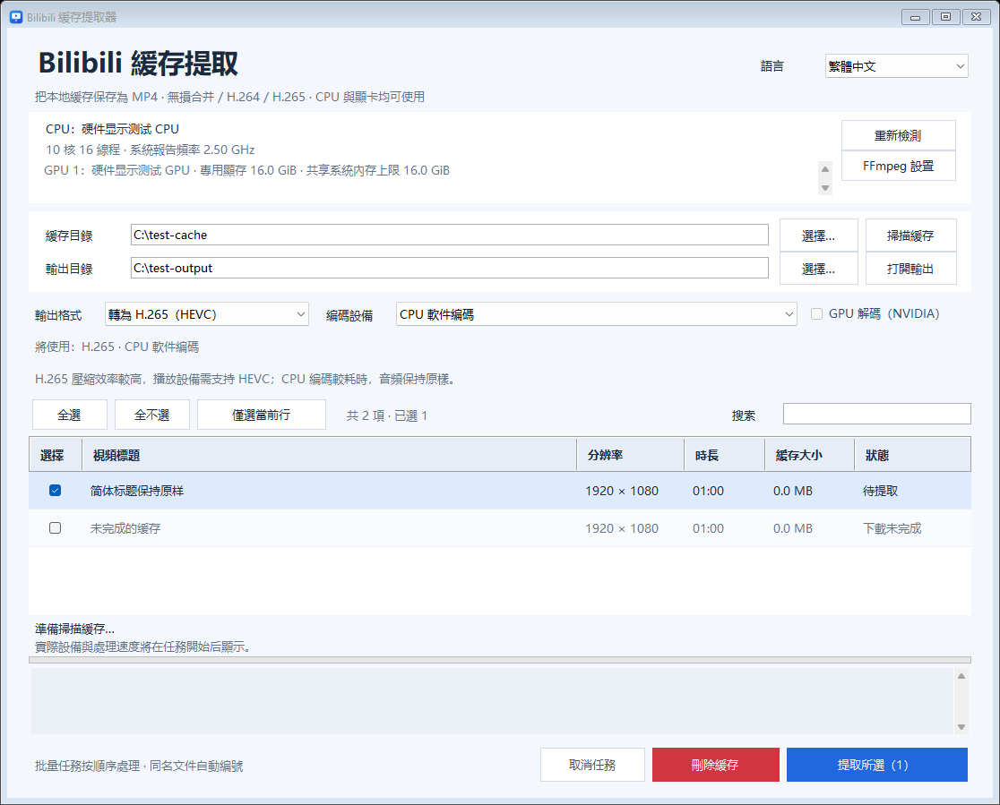
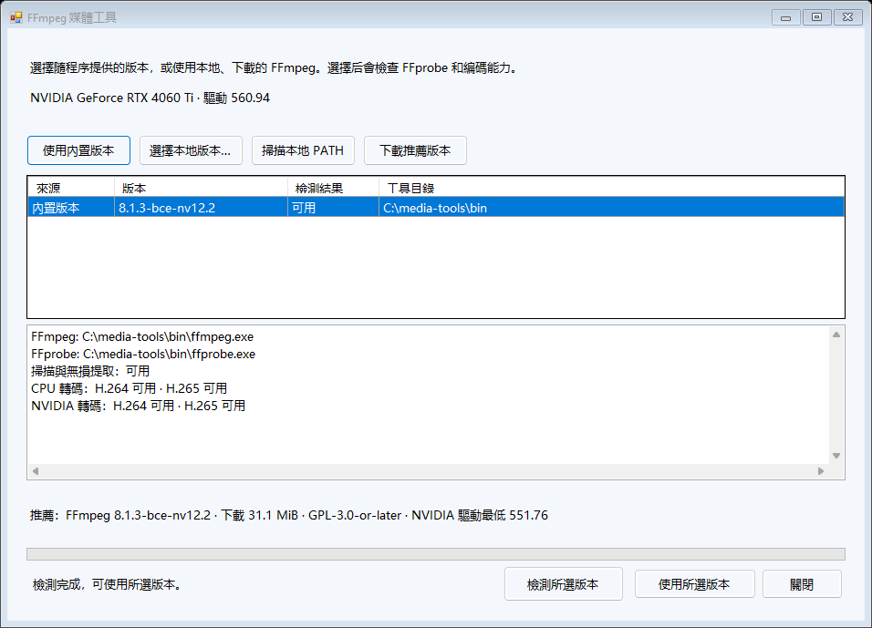

# Bilibili 緩存提取器

[English](README.md) | [简体中文](README.zh-CN.md) | **繁體中文**


將 Windows 上的 Bilibili 本機緩存儲存為 MP4，支援保留原始音訊與視訊壓縮資料的無損提取，以及 CPU 或顯示卡加速的 H.264/H.265 轉碼。



介面截圖使用合成的介面測試資料。

## 功能

- 遞迴掃描 `.m4s` 檔案，讀取 `videoInfo.json` 中的影片標題和分 P 標題。
- 無損提取、H.264 與 H.265/HEVC 三種輸出模式。
- CPU、NVIDIA NVENC、Intel Quick Sync、AMD AMF 編碼裝置選擇與自動回退。
- 批次勾選、標題搜尋、進度顯示、取消任務與同名檔案自動編號。
- 簡體中文、繁體中文和 English 介面。
- 預覽待刪除緩存，確認後移入 Windows 資源回收筒。
- 與圖形介面共用處理引擎的命令列入口。

## 開始使用

**1.4.1** 下載入口：[Release 頁面](https://github.com/Sulock/BiliCacheExtractor/releases/tag/v1.4.1) · [Windows x64 程式套件](https://github.com/Sulock/BiliCacheExtractor/releases/download/v1.4.1/BiliCacheExtractor-v1.4.1-win-x64.zip) · [原始碼 ZIP](https://github.com/Sulock/BiliCacheExtractor/releases/download/v1.4.1/BiliCacheExtractor-v1.4.1-source.zip) · [SHA-256 驗證檔案](https://github.com/Sulock/BiliCacheExtractor/releases/download/v1.4.1/SHA256SUMS.txt)。

已驗證環境為 **Windows 11 23H2 x64、.NET Framework 4.8.1**。程式編譯為 x64，介面、硬體偵測和資源回收筒功能使用 Windows API。只有重新產生圖示時需要 Python。

### 下載執行

1. 將 Windows x64 程式套件解壓縮至可寫入的目錄。
2. 按兩下 `BiliCacheExtractor.exe`。套件內建 **FFmpeg 8.1.3、NVENC API 12.2 的可攜式建置**與 FFprobe。

點選硬體資訊旁的 **FFmpeg 設定**，可使用內建版本、選擇本機版本、掃描本機 PATH，或下載建議版本。偵測結果會列出實際工具路徑與 H.264/H.265 的 CPU、顯示卡編碼能力；程式使用選定的 FFmpeg/FFprobe 配套檔案。缺少工具時，啟動會先開啟設定視窗。

內建建置的 NVIDIA 介面要求 Windows 驅動程式 **551.76 或更新版本**，已在 RTX 4060 Ti、560.94 驅動程式下驗證 NVIDIA H.264/H.265 編碼。無損提取不需要視訊編碼器。請參閱[工具設定](tools/README.md)與 [FFmpeg 原始碼和建置資料](third_party/FFMPEG-SOURCES.md)。



### 從原始碼建置

1. 解壓縮原始碼 ZIP 或複製本儲存庫。
2. 執行 `Install-FFmpeg.cmd`，或依照[媒體工具說明](tools/README.md)手動設定 FFmpeg/FFprobe。
3. 在原始碼目錄的 PowerShell 中執行：

```powershell
powershell.exe -NoProfile -ExecutionPolicy Bypass -File .\build.ps1
```

4. 按兩下產生的 `BiliCacheExtractor.exe`。

建置使用 Windows .NET Framework C# 編譯器，無需下載 NuGet 套件。編譯 C# 不需要 FFmpeg；執行軟體和媒體測試時需要。系統缺少 .NET Framework 4.8.1 時，請先安裝該執行階段。

## 圖形介面

選擇緩存目錄並掃描，勾選影片，設定輸出目錄和格式後按一下「提取所選」。預設緩存目錄為目前使用者 Windows 影片資料夾下的 `bilibili`，預設輸出至程式旁的 `提取的视频` 資料夾。

| 模式 | 運作方式 |
| --- | --- |
| 無損提取 | 複製音訊與視訊壓縮資料並封裝為 MP4，保留來源編碼與畫質，通常最快。 |
| 轉為 H.264 | 重新編碼視訊，直接複製音訊，適合需要廣泛播放相容性的情況。 |
| 轉為 H.265（HEVC） | 重新編碼為 HEVC，使用 MP4 `hvc1` 標記，直接複製音訊，需要播放器支援 HEVC。 |

程式先用短片實際初始化各編碼器，再提供可用裝置。自動模式按 NVIDIA → Intel → AMD → CPU 的順序選擇；執行時硬體編碼失敗會嘗試下一種可用裝置，保持輸出格式不變。手動選擇裝置時，該裝置失敗會回報錯誤。NVIDIA 路徑可使用 GPU 解碼，失敗後會先嘗試 CPU 解碼。

搜尋會保留既有勾選，並顯示被搜尋隱藏的勾選數量。「全選」選擇目前的搜尋結果，「全不選」清除全部勾選。任務依序執行；取消會終止目前任務並清理暫存檔案，已完成的影片則會保留。同名輸出自動加上 `(2)`、`(3)` 等編號。

尚未下載完成、損壞或缺少音訊與視訊軌道的緩存會顯示原因。存在多條候選軌道時，視訊優先選擇最高解析度，相同解析度則選擇較大的檔案；音訊選擇最大的軌道。支援一般 `.m4s` 和帶有九位元組 `000000000` 前綴的輸入。

### 刪除緩存

紅色「刪除緩存」按鈕會開啟確認視窗，列出所選檔案和總容量，預設操作為「取消」。確認後，僅將所選項目掃描到的 `.m4s` 與 `videoInfo.json` 移入 Windows 資源回收筒，可以從資源回收筒還原。已匯出的 MP4、無關檔案和目錄會保留。

刪除前會檢查掃描目錄、檔案類型、連結路徑，以及確認後檔案是否改變。不支援相應資源回收筒操作的位置會回報錯誤並保留檔案。

### 設定與記錄

程式旁的 `settings.json` 儲存語言、目錄、輸出格式和裝置選項。程式目錄和輸出目錄需要可寫入。介面記錄顯示在視窗內，CLI 記錄輸出至終端機；測試結果放在 `verification/`。

## 命令列

```powershell
$cachePath = Join-Path ([Environment]::GetFolderPath('MyVideos')) 'bilibili'
.\BiliCacheExtractor.Cli.exe --help
.\BiliCacheExtractor.Cli.exe --hardware
.\BiliCacheExtractor.Cli.exe --scan $cachePath
.\BiliCacheExtractor.Cli.exe --export $cachePath '.\output' copy
.\BiliCacheExtractor.Cli.exe --export $cachePath '.\output' h264 --device cpu
.\BiliCacheExtractor.Cli.exe --export $cachePath '.\output' h265 --device nvidia
```

`--export` 處理指定目錄下的全部可提取影片。裝置參數為 `auto`（預設）、`cpu`、`nvidia`、`intel`、`amd`。測試時可額外傳入正數秒數限制輸出長度；舊參數 `gpu` 等同於 `h264 --device nvidia`。

## 開發與測試

```powershell
powershell.exe -NoProfile -ExecutionPolicy Bypass -File .\build.ps1
powershell.exe -NoProfile -ExecutionPolicy Bypass -File .\tests\run.ps1
```

重新編譯前請關閉圖形介面。測試預設產生合成的音訊、視訊與緩存，不需要個人影片。可用 `-CachePath 'C:\path\to\cache'` 指定包含可提取影片的真實緩存，用於取消測試。加上 `-Recycle` 會額外對 `verification/` 中由測試建立的檔案執行真實回收與還原。

1.4.1 共通過 113 項檢查：21 項工具管理、39 項媒體、46 項介面與 7 項資源回收筒計畫檢查。測試涵蓋合成緩存、CPU 與可用顯示卡轉碼、輸出解碼、壓縮資料雜湊、取消清理、三語介面、工具選擇與安裝驗證。沒有對應硬體時，以模擬工具驗證 Intel/AMD 選擇邏輯；實際回收與還原仍需明確加入 -Recycle。

原始碼結構：

- `src/`：介面、語言、緩存掃描、匯出、硬體偵測和緩存回收。
- `tests/`：媒體、介面及資源回收筒測試。
- `assets/`：可編輯的 SVG 圖示與產生的 PNG、ICO。
- `tools/make-icon.py`：可選的圖示產生器，需要 Python 3.9+、Pillow 與 NumPy。
- `build.ps1`：使用系統 C# 編譯器產生 GUI 與 CLI。
- `Install-FFmpeg.ps1` 與 `tools/ffmpeg-recommended.json`：驗證下載後安裝固定版本的媒體工具。
- `package.ps1`：從已提交的原始碼建置發布套件，附上對應原始碼 ZIP 和 SHA-256 驗證檔案。

重現離線套件可執行 `powershell.exe -NoProfile -ExecutionPolicy Bypass -File .\package.ps1 -Version 1.4.1 -Commit HEAD -FFmpegArchive 'C:\path\to\FFmpeg-8.1.3-bce-nv12.2-win-x64.zip' -FFmpegSourceKit 'C:\path\to\FFmpeg-8.1.3-bce-nv12.2-source-kit.zip'`。請使用同一 Release 的 FFmpeg 執行套件 ZIP 與完整原始碼資料 ZIP，腳本會核對固定雜湊。輸出位於 `release-v1.4.1/`；再次建置時請用 `-OutputDirectory` 指定新的輸出目錄。

## 回報問題

請在 [Issues](https://github.com/Sulock/BiliCacheExtractor/issues) 提供 Windows 版本、程式版本、FFmpeg 版本、所選格式／裝置與重現步驟。分享記錄和截圖前，請檢查其中的路徑、影片標題及其他個人資訊。

## 授權條款

專案採用 **GPL-3.0-only**，完整正文請參閱 [LICENSE](LICENSE)。FFmpeg 等外部元件遵循各自的授權條款，詳見[第三方說明](THIRD_PARTY_NOTICES.md)。

Copyright (C) 2026 Sulock.
